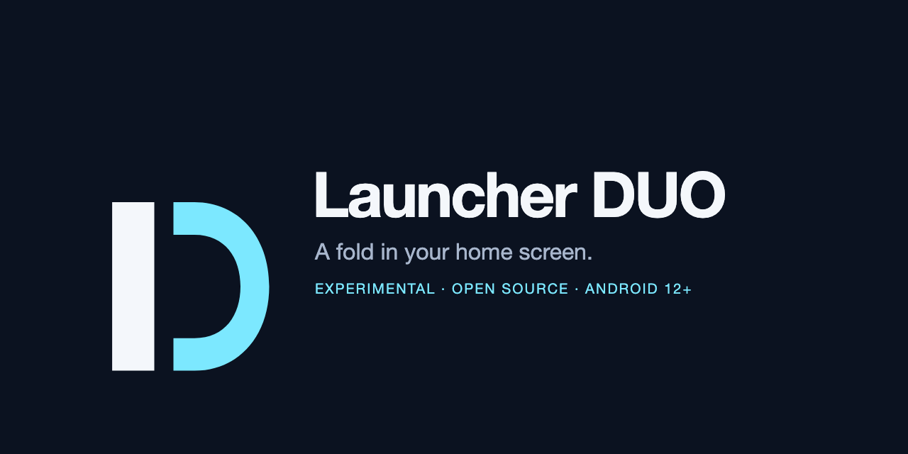

# Launcher DUO

**An experimental, open-source replica of the iPhone Fold DUO flex animation — on Android, and only for fun.**

Tilting the phone bends the home screen into the edge you tilt toward: the picture
compresses, frosts and darkens, with a thin black sliver where the glass leaves the
panel. The opposite edge is the hinge and stays pinned and sharp, so there is no seam.

[](https://github.com/StarkDroid/LauncherDuo/releases/latest)
[](LICENSE)
[](https://developer.android.com/about/versions/12)

Nothing is replaced. The launcher keeps working underneath; the effect is an
overlay that is only visible while you tilt.

## How it works

1. **Tilt.** `TiltTracker` reads `TYPE_GAME_ROTATION_VECTOR` (fused accelerometer +
   gyroscope) and measures the screen normal against a calibrated centre. Vertical
   tilt is ignored; yaw and in-plane roll are summed, then filtered with a one-euro
   filter so hand tremor does not reach the shader.
2. **Centre.** The effect is off until the phone has been held still (under 15°/s
   for about a second) while upright. That pose becomes `zero`. Holding still again
   re-zeroes it, so there is never a permanent bend.
3. **Frame.** While the home screen is up and flat, the accessibility service takes
   one screenshot roughly twice a second. The shader samples that image. It is
   never taken while the overlay is visible, otherwise the effect would record
   itself.
4. **Warp.** `res/raw/duo_edge.agsl` is an AGSL port of the iPhone DUO fold. Per
   pixel it traces the eye ray through the tilted glass to the panel plane, blurs
   with a Vogel disk whose radius grows with the glass-to-panel gap, dims in
   proportion to that blur, and returns black where the kernel misses the panel.
   The plane sits behind the glass, so content compresses inward.
5. **Draw.** One accessibility overlay window, 30 fps, `FLAG_NOT_TOUCHABLE` — taps
   and swipes still reach the launcher.

The effect exists only on the launcher's home screen, is hidden on the lock screen,
and is cleared the moment another app comes forward.

## Permissions

Only one: an **accessibility service**. It is used for exactly three things.

| Capability | Why |
|---|---|
| Draw overlays (`TYPE_ACCESSIBILITY_OVERLAY`) | to paint the fold above the launcher |
| Take screenshots (`canTakeScreenshot`) | one still frame of the home screen, twice a second |
| Window state events | to know when the home screen is in front and the lock screen is up |

`canRetrieveWindowContent` is only used to read the foreground *package name*. No
window content, text, keystrokes or notification data is read, stored or
transmitted. Screenshots are held in memory and released as soon as the home screen
leaves the foreground. There is no internet permission.

## Calibration lifecycle

1. Flipping the switch **in the app** does not calibrate anything. It arms the
   service and sets a "waiting for the home screen" flag; the overlay stays hidden
   even if the sensors move.
2. The gate is decided by the **focused window**, polled every 250 ms
   (`rootInActiveWindow`, falling back to the window list). Window-state events are
   used only as a fast path and deliberately ignore our own package, because the
   overlay window would otherwise toggle the gate and the effect would stutter at
   1 Hz.
3. When the launcher is confirmed in front, calibration starts: a 700 ms window of
   heading samples from which the **median** becomes the centre, accepted once three
   quarters of the samples agree with it to within 4°. A hand holding a phone
   "still" sways by a couple of degrees continuously, so an instantaneous reading
   or a strict no-motion rule never settles; a median does, and it still refuses to
   commit during a deliberate turn. A chip reports "Recalibrating…" — only if the
   wait actually exceeded 400 ms — and then "Fold ready".
4. The centre is the heading the screen faces at the moment the window commits.
   `TYPE_GAME_ROTATION_VECTOR` becomes a rotation matrix, that matrix is remapped so
   the viewing direction is the frame's vertical reference, and
   `SensorManager.getOrientation` reports its compass heading. The fold is driven by
   the change since the committed heading, so it reads exactly 0° while the phone
   stays where it was calibrated, and the same amount with opposite signs for equal
   turns either way. Rolling the phone in the hand or pitching it top-to-bottom does
   not enter the signal at all.
5. The heading is only read while the screen faces sideways, within 45° of the
   horizon: a phone lying flat or facing the ceiling has no meaningful left turn.
   On top of that, nothing bends until the phone has physically left the committed
   attitude by 4°. That second check is the angle between two attitudes — a trace,
   the same number whichever way the platform orders its axes — so a signed heading
   that is somehow wrong cannot produce a fold on its own. When the two disagree the
   service logs it instead of warping.
6. A tap, or pulling down the shade, hides the fold instantly and re-runs step 3,
   rate limited to one recalibration per 1.2 s. Launcher content changes only count
   while the fold is actually on screen: the clock and the At a Glance card repaint
   by themselves, and interrupting for those would make the effect blink. Leaving
   the launcher abandons any calibration in progress, so a centre is never committed
   from a pose found inside another app.

## Invariants — do not break these

The calibration arithmetic is unit tested, because every bug this effect has had
came from a wrong number rather than a wrong idea:

```
./gradlew test          # or: ./gradlew :app:testDebugUnitTest
```

`app/build/reports/tests/` explains any failure. The rules the tests pin down:

- **Units.** `SensorManager.getOrientation` reports **radians**; everything else in
  the app is **degrees**. The conversion happens in `PoseCalibration.commit` and
  `PoseCalibration.yawFrom` and nowhere else. Adding degrees to radians makes the
  fold snap to one side the moment it says "ready", which is the exact bug these
  tests were written for.
- **The centre is a median**, never an instantaneous reading, and it needs 75% of
  the window within 4° of itself. A hand holding a phone still sways by a couple of
  degrees, so a strict no-motion rule never settles and an instantaneous sample
  inherits whatever the tremor was doing.
- **Zero at the committed pose, symmetric either side**, for every compass heading
  and across the ±180° seam.
- **Nothing bends until the phone has physically left the committed attitude by 4°.**
  This is the last line of defence: it is measured as the angle between two
  attitudes, which does not depend on any axis convention, so a heading that is
  somehow wrong can block the fold but cannot invent one.
- **The fold only ever draws on the launcher**, only after a confirmed arrival there,
  and only once a centre was committed while the launcher was in front.

If you change any of the above, change the tests in the same commit and say why.

## Turning it on

The effect never resumes by itself after a reboot or an accessibility rebind — the
switch has to be flipped in the app. That is deliberate: enabling it starts a fresh
calibration of how the phone is being held, so the fold is measured against the
pose you are actually using rather than one captured days ago.

## Install

Download `LauncherDUO-0.1.0.apk` from [Releases](https://github.com/StarkDroid/LauncherDuo/releases),
open it on the phone and enable **Launcher DUO effect** under Settings → Accessibility.
No root, no Shizuku, no ADB.

- Package: `dev.trishi.launchertuner`
- Android 12 (API 31) and up
- Signed with the maintainer's release key — the certificate SHA-256 is in the release notes

## Build

```bash
./gradlew test                    # the calibration arithmetic, on the JVM, no device
./gradlew :app:assembleDebug      # app/build/outputs/apk/debug/app-debug.apk
./gradlew :app:assembleRelease
```

Requires JDK 17 and the Android SDK (compileSdk 37). No root, no Shizuku, no ADB
after install.

## Limits

The frame is a still image captured while flat, so animations at the edge freeze
while the effect is visible. There are no live previews of other apps because
task snapshots are not readable without root.

## The mark

<p align="center">
  
</p>

A **D** whose hinge edge stays pinned, whose glass leaves the panel at a thin
sliver, and whose far side is foreshortened — the effect, drawn as a letter. Ink
`#0B1220`, hinge `#F4F7FB`, glass `#7CE8FF`. Files, palette and clear-space rules are
in [docs/brand](docs/brand). The adaptive icon is
`app/src/main/res/drawable/ic_launcher_foreground.xml`.

## Licence

MIT — see [LICENSE](LICENSE).

Launcher DUO is an unofficial experiment. It is not affiliated with, endorsed by or
sponsored by Apple; no Apple code, assets or trademarks are used. "iPhone" is a
trademark of Apple Inc.
